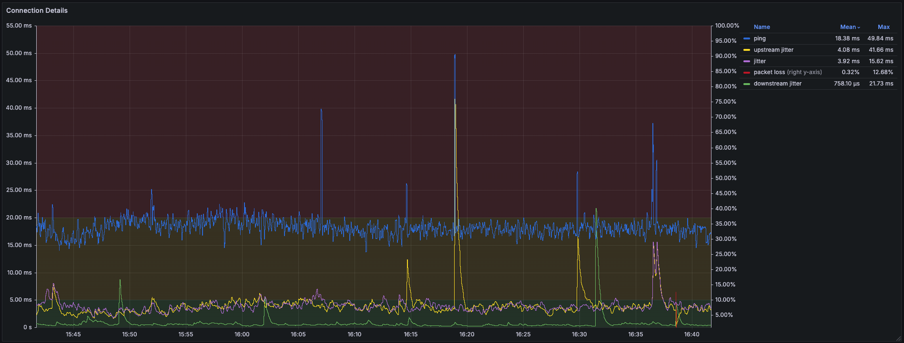

# jittermon
[](https://codecov.io/gh/wafer-bw/jittermon)
[](https://github.com/wafer-bw/jittermon/actions/workflows/cicd.yml)


Jittermon is a network monitoring tool specifically focused on ping & jitter. It
can be run standalone, providing monitoring of packet loss, ping, and jitter or
with a remote peer allowing independent monitoring of upstream and downstream
jitter. It uses [Loki](https://grafana.com/oss/loki/), [Grafana](https://grafana.com/),
and [Prometheus](https://prometheus.io/) for storing and visualizing data.

## Author's Notes
Unfortunately, I don't have any plans to maintain this project in any serious
capacity aside from yearly [dependabot](https://docs.github.com/en/code-security/tutorials/secure-your-dependencies/dependabot-quickstart-guide)
PRs. If you would like to take this project further, please feel free to fork or
copy it.

Follow the getting started section below to begin. Advanced readers may also
want to check out the [contributing](./.github/CONTRIBUTING.md) file for more
technical details.

<details>
<summary>Background Story (click to expand)</summary>

A year ago I was experiencing strange internet issues that were hard to identify
in a meaningful way to my ISP. The best information I had was that I was seeing
elevated packet loss, ping, & jitter, and that during such events on a VoIP call
I could hear others but they couldn't hear me. At the time I was also using
[PingPlotter](https://www.pingplotter.com/) (which heavily inspired this project
and I recommend you check out) but it couldn't explain the issue fully.

Oddly enough, while playing [Deadlock](https://store.steampowered.com/app/1422450/Deadlock/)
with their network graphs enabled I noticed something peculiar about my issue
that PingPlotter wasn't able to see: it was primarily my upstream connection
that was experiencing problems. So I set out to measure and observe my upstream
and downstream jitter similar to the Deadlock network graphs by creating this
tool.

I spent a lot of time going back and forth on the complexity of the application
and its design, flip-flopping on topics such as an extensible library, in-house
visualization tools, executable binary, and other implementation details.
However, I have to move on from the project and wanted it in a usable open
source state so I tightened things up to just this very simple tool you run in
Docker.

</details>

## Getting Started
1. Clone the repo or download and extract the source code from the latest
   version [here](https://github.com/wafer-bw/jittermon/releases).
2. Ensure you have the following requirements installed:
   1. [docker](https://www.docker.com/get-started/) (if you aren't sure how to
      install, use the Download Docker Desktop button)
   2. [docker compose](https://docs.docker.com/compose/install) (skip this step
      if you installed docker desktop in the previous step)
   3. [flyctl](https://fly.io/docs/flyctl/install/) (only if you plan to follow
      the advanced getting started guide below).
3. Follow either the [Standalone](#standalone) (basic, free) or
   [With Remote Peer](#with-remote-peer) (advanced, may incur costs) section
   below to get started.

Prefer not to use docker? See [Without Docker](#without-docker). Want your
dashboards in the cloud instead of on your machine? See
[Grafana Cloud](#grafana-cloud).

> [!NOTE]
> Attention Windows Users: After installing docker desktop above you'll likely
> have to restart your machine. You may also have to run [`wsl --install`](https://learn.microsoft.com/en-us/windows/wsl/install)
> or `wsl --update` in a command prompt window after restarting. For running the
> commands below you'll need to open a command prompt window in the same folder
> where you cloned or extracted the source code which is explained [here](https://superuser.com/a/1524862).

### Standalone
Monitor your packet loss, ping, and jitter (basic).

1. Run the app.
   ```sh
   docker compose up -d
   ```
2. View metrics in your browser at http://localhost:3000/d/aec2tnhcwbuo0b\
   (username: `admin`, password: `demo`).
3. Stop the app.
   ```sh
   docker compose down
   ```

### With Remote Peer
Monitor your packet loss, ping, jitter, upstream jitter, and downstream jitter
(advanced).

For our remote peer we're using [fly.io](https://fly.io/) because it is cheap
and easy. Before proceeding, review their pricing details [here](https://fly.io/pricing/)
to make sure you're comfortable with any costs you may incur. When this project
started they had free allowances but that doesn't seem to be the case anymore as
stated [here](https://fly.io/docs/about/pricing/#legacy-free-allowances).

1. Review [fly.toml](./fly.toml), you'll want to update `primary_region` to your
   own [region](https://fly.io/docs/reference/regions).
2. Deploy to fly
   ```sh
   fly launch --ha=false
   # when executing the above follow these choices for the prompts:
   # ? Would you like to copy its configuration to the new app?
   #   Yes
   # ? Do you want to tweak these settings before proceeding?
   #   No
   # ? Create .dockerignore from 1 .gitignore files?
   #   No
   # ? Would you like to allocate dedicated ipv4 and ipv6 addresses now?
   #   Yes
   ```
3. Set the remote peer's send address to your IP address. Make sure you've port
   forwarded and replace `YOURIPHERE` with your public IPv4 address (on Windows
   you will likely also have to [open the port in Windows Defender](https://learn.microsoft.com/en-us/answers/questions/3864685/how-to-do-port-forwarding-or-port-opening-in-windo)).
   ```sh
   fly secrets set JITTERMON_PTP_SEND_ADDRS=YOURIPHERE:8081
   # e.g.
   # fly secrets set JITTERMON_PTP_SEND_ADDRS=123.123.123.123:8081
   ```
4. Save the IP address of your fly app from step 2 above to `.env` (replace
   `FLYADDRESS` with the actual IPv4 address).
   ```sh
   echo JITTERMON_PTP_SEND_ADDRS=FLYADDRESS:8080 >> .env
   # e.g.
   # echo JITTERMON_PTP_SEND_ADDRS=123.123.123.123:8080 >> .env
   ```
5. Run the app.
   ```sh
   docker compose up -d
   ```
6. View metrics in your browser at http://localhost:3000/d/aec2tnhcwbuo0b\
   (username: `admin`, password: `demo`).
7. Stop the app.
   ```sh
   docker compose down
   ```

### Grafana Cloud
Push metrics to [Grafana Cloud](https://grafana.com/products/cloud/) over
[OTLP](https://opentelemetry.io/docs/specs/otlp/) in addition to, or instead of,
the local Grafana stack. This works with any of the setups above or below and
the free tier is plenty for a single host.

1. In the [Grafana Cloud portal](https://grafana.com/orgs) open your stack, find the **OpenTelemetry** tile
   and click **Configure**. Generate an API token and copy the environment
   variables it shows you.
2. Add them to `.env` (or set them in your shell if running
   [without docker](#without-docker)). They will look something like this:
   ```sh
   OTEL_EXPORTER_OTLP_PROTOCOL=http/protobuf
   OTEL_EXPORTER_OTLP_ENDPOINT=https://otlp-gateway-prod-us-east-0.grafana.net/otlp
   OTEL_EXPORTER_OTLP_HEADERS=Authorization=Basic%20BASE64TOKENHERE
   OTEL_METRIC_EXPORT_INTERVAL=10000 # optional, push every 10s instead 60s default.
   ```
3. Run the app as usual. If you only want to send to Grafana Cloud and don't
   need the local Grafana stack you can start just jittermon.
   ```sh
   docker compose up -d --no-deps jittermon
   ```
4. In Grafana Cloud go to **Dashboards > New > Import**, upload
   [default.json](./app/grafana/dashboards/default.json), then pick your
   `grafanacloud-*-prom` data source from the **Metrics** dropdown at the top
   of the dashboard. The log panels only work with the local stack.

Only the `http/protobuf` OTLP protocol is supported. Any of the standard
[OTLP exporter env vars](https://opentelemetry.io/docs/languages/sdk-configuration/otlp-exporter/)
can be used, including the `_METRICS_` specific variants.

### Without Docker
Run jittermon directly on Windows, macOS, or Linux. Without docker there is no
local Grafana so pair this with [Grafana Cloud](#grafana-cloud), or point your
own Prometheus at http://localhost:8082/metrics.

1. Download the archive for your OS and CPU from the latest
   [release](https://github.com/wafer-bw/jittermon/releases) and extract it.
   (`amd64` is most Intel/AMD machines, `arm64` is Apple Silicon and newer ARM
   machines, `armv7` is older Raspberry Pis.)
2. Configure it with environment variables (see
   [Configuration](#configuration)) and run it from the extracted folder.
   ```sh
   # macOS / Linux
   export JITTERMON_PTX_ADDRS=8.8.8.8:53
   export OTEL_EXPORTER_OTLP_ENDPOINT=https://otlp-gateway-prod-us-east-0.grafana.net/otlp
   export OTEL_EXPORTER_OTLP_HEADERS=Authorization=Basic%20BASE64TOKENHERE
   ./jittermon
   ```
   ```powershell
   # Windows (PowerShell)
   $env:JITTERMON_PTX_ADDRS = "8.8.8.8:53"
   $env:OTEL_EXPORTER_OTLP_ENDPOINT = "https://otlp-gateway-prod-us-east-0.grafana.net/otlp"
   $env:OTEL_EXPORTER_OTLP_HEADERS = "Authorization=Basic%20BASE64TOKENHERE"
   .\jittermon.exe
   ```
3. Press `Ctrl+C` to stop it.

> [!NOTE]
> The binaries are not signed. On macOS you may need to run
> `xattr -d com.apple.quarantine ./jittermon` before it will open, and Windows
> may show a SmartScreen warning you'll need to click through.

> [!TIP]
> You can also build it yourself with [go](https://go.dev/doc/install) by running
> `go build .` in the source folder.

## Configuration
Jittermon is configured with environment variables. When using docker compose
put overrides in `.env`.

| Variable | Default | Description |
| --- | --- | --- |
| `JITTERMON_ID` | hostname | Name of this host, used as the `src`/`dst` label on metrics. |
| `JITTERMON_PTX_ADDRS` | | Comma separated `host:port` UDP addresses to measure ping, jitter, and packet loss against (e.g. `8.8.8.8:53`). |
| `JITTERMON_PTX_INTERVAL` | `1s` | How often to send to `JITTERMON_PTX_ADDRS`. |
| `JITTERMON_PTP_LISTEN_ADDR` | | Address to listen on for a remote peer (e.g. `:8081`). |
| `JITTERMON_PTP_SEND_ADDRS` | | Comma separated `host:port` addresses of remote peers. |
| `JITTERMON_PTP_INTERVAL` | `1s` | How often to poll remote peers. |
| `JITTERMON_METRICS_SERVER_ADDR` | `:8082` | Address to serve Prometheus metrics on. Set to empty to disable. |
| `JITTERMON_LOG_LEVEL` | `INFO` | `DEBUG`, `INFO`, `WARN`, or `ERROR`. |
| `JITTERMON_SHUTDOWN_TIMEOUT` | `5s` | How long to wait for pending metrics to flush on shutdown. |
| `OTEL_EXPORTER_OTLP_ENDPOINT` | | Enables pushing metrics over OTLP, see [Grafana Cloud](#grafana-cloud). |
